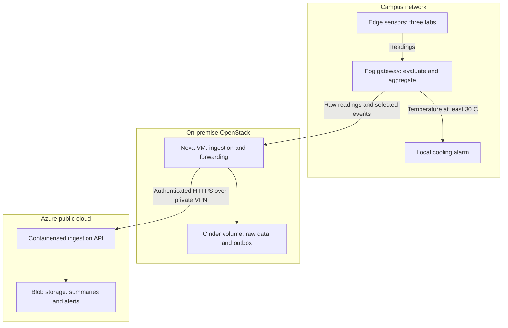

# Unit 6: Hybrid cloud, fog and edge computing

I designed a smart-campus temperature-monitoring architecture and a Python simulation of its data flow. The design uses OpenStack on premises and Azure as the public-cloud component. **OpenStack and Azure are proposed deployment targets, not installed services in this exercise.** The executable is a local, discrete-event model using synthetic sensor readings; it makes no cloud API calls. Its ticks represent event order, not measured seconds or a real-time guarantee.

## My architecture



The VPN, TLS, storage durability and APIs shown above are design requirements, not simulated controls.

| Layer | Proposed implementation | Purpose and boundary |
|---|---|---|
| Edge | Temperature sensors in three campus labs | Produce measurements; no public-cloud credentials on sensors |
| Fog | Campus gateway with threshold rules and three-tick aggregation | Make local alarm decisions without a WAN round trip |
| Private cloud | Nova Linux VM; Neutron application network and restricted security groups; Cinder volume | Keep raw records and a durable forwarding outbox on premises |
| OpenStack management | Keystone identity, Glance image service and Placement alongside Nova | Support cloud resource provisioning; separate management and sensor networks |
| Public cloud | Containerised ingestion API and Azure Blob storage | Retain selected records for later analysis; outside the urgent control path |

Nova provides compute instances, while Neutron provides their networking (OpenStack, n.d.a; n.d.b). I place the fog gateway near the sensors and the private-cloud service in the campus data centre: their roles are distinct even though both remain on premises. This distributed processing approach is consistent with the NIST fog model (Iorga et al., 2018).

## How I would implement the design

1. Provision the OpenStack project, identity permissions, image, application network, VM and persistent volume. Restrict sensor-to-ingestion access and keep administration on a separate network.
2. Run the gateway rules locally. Set the 30 C threshold as a demonstration value; agree real operating limits with facilities staff before use.
3. Store each raw reading and assign a stable event ID. Commit selected events to a durable outbox before acknowledging them.
4. Deploy the public ingestion API and storage. Establish the VPN and authenticated HTTPS connection. Use an application identity with only the storage permissions it needs.
5. Retry outbox events after connection failures. Make ingestion idempotent using event IDs. Rate-limit replay so a backlog does not overwhelm the endpoint.
6. Test local alarms, WAN disconnection, reconnection, gateway restarts, disk exhaustion and duplicate delivery before enabling physical control.

These are implementation steps for the proposed architecture. My completed practical artefact below simulates the decision and forwarding logic only.

## My simulation

Files: [Python simulation](simulate.py), [configuration](config.json), [results](results/metrics.json), [event log](results/execution.log).

Run with Python 3, from this directory:

```bash
python3 simulate.py --output results
```

No additional packages, cloud account, credentials or paid resources are needed. The output directory is overwritten on each run; choose a different directory to preserve another scenario.

Three simulated sensors generate one reading per tick for twelve ticks. The fog rule evaluates each reading immediately within its tick. An alert is raised at or above 30 C. Every three ticks, one mean per device is queued for the cloud. All raw readings are retained in the local model. The WAN is unavailable at ticks 4–7 and returns at tick 8. The cloud model receives buffered alerts and summaries after recovery.

The script models local storage and its outbox in memory, then exports JSONL files. It does **not** implement a durable queue, network transport, sensor hardware or OpenStack/Azure adapters. It cannot survive a process crash. Unique IDs prevent duplicate acceptance within one run; duplicate transmission and restart recovery require further tests.

### Recorded reference-run results

The accompanying results were generated by executing the script in the preparation environment, not on my Mac or in deployed clouds.

| Observation | Result |
|---|---:|
| Raw readings retained locally | 36 |
| Local alerts | 5 |
| Alerts generated during WAN outage | 4 |
| Summaries forwarded | 12 |
| Total cloud records | 17 |
| Record-count reduction against forwarding all raw readings | 52.78% |
| Raw JSON payload bytes | 2,460 |
| Selected JSON payload bytes | 1,856 |
| JSON payload-byte reduction | 24.55% |
| Maximum alert delay to cloud model | 4 ticks |
| Outbox records remaining after recovery | 0 |

Byte totals exclude JSONL newlines and transport overhead. The comparison uses the same input trace but different record schemas: 36 raw readings versus 12 summaries plus five alerts. It is an illustrative payload comparison, not measured network traffic, a bandwidth benchmark or a cost estimate.

Reference checks passed for the configured recovery scenario. Additional executions with no outage and a permanent outage also passed their expected checks: no-outage cloud alert delay was zero ticks; with permanent loss of connectivity, all five local alerts still occurred and all 17 selected records remained queued. These checks validate the model's logic under these inputs, not the reliability of deployed infrastructure.

## My reflection

I used a campus example because it makes the placement decision concrete: an overheating lab needs a local response even when the internet connection is unavailable. Sending every reading to a distant service would put that response behind a dependency the campus cannot fully control. In my design, fog processing handles the urgent decision, while the public cloud receives information for later review.

The outage scenario helps explain the difference between local availability and cloud visibility. Four alerts were generated while the WAN was unavailable. They remained available locally but arrived later in the cloud model. A remote dashboard could therefore appear quiet while a local incident is developing. I would display a last-contact timestamp and an explicit stale-data warning rather than treating missing telemetry as evidence of normal operation.

Aggregation also involves a trade-off. Fewer records leave the campus, but averages can hide short temperature spikes. I kept alerts separate from summaries so the threshold events would not disappear into the averages. The run reduced record count by 52.78%, whereas JSON payload bytes fell by 24.55%. This difference matters: counting messages alone would overstate the reduction in data volume. Neither figure establishes actual network savings.

The most significant limitation is the gap between the proposed storage and the executable model. The architecture requires a persistent outbox, but the script uses memory. It demonstrates reconnection during a running process, not recovery after a gateway crash. My next step would be a transactional local queue, followed by a restart test that checks whether acknowledged events remain recoverable. The fog gateway itself would also need monitoring and a failure strategy; moving decisions closer to devices does not remove single points of failure.

I used the NIST Cybersecurity Framework as a basis for deciding what must be governed and verified, rather than as proof that the design is secure (NIST, 2024). My proposed controls include named ownership of alarm thresholds, an inventory of devices, restricted identities, encrypted links, stale-data detection, incident procedures and tested restoration. These controls are not implemented by the simulation.

To limit vendor dependence, I used a provider-neutral JSON event format and kept the forwarding boundary separate from the sensor rules. A future adapter could send the same events to another endpoint. However, changing providers would still require work on identities, networking, storage semantics and operations. OpenStack and containers reduce some dependencies; they do not make migration automatic. I would test an export and replay into a second storage target before claiming portability.

## References

Iorga, M., Feldman, L., Barton, R., Martin, M.J., Goren, N.S. and Mahmoudi, C. (2018) *Fog Computing Conceptual Model*. NIST SP 500-325. Available at: https://doi.org/10.6028/NIST.SP.500-325 (Accessed: 15 November 2026).

National Institute of Standards and Technology (NIST) (2024) *The NIST Cybersecurity Framework (CSF) 2.0*. NIST CSWP 29. Available at: https://doi.org/10.6028/NIST.CSWP.29 (Accessed: 15 November 2026).

OpenStack (n.d.a) *OpenStack Compute (nova)*. Available at: https://docs.openstack.org/nova/latest/ (Accessed: 15 November 2026).

OpenStack (n.d.b) *Welcome to Neutron’s documentation!*. Available at: https://docs.openstack.org/neutron/latest/ (Accessed: 15 November 2026).
