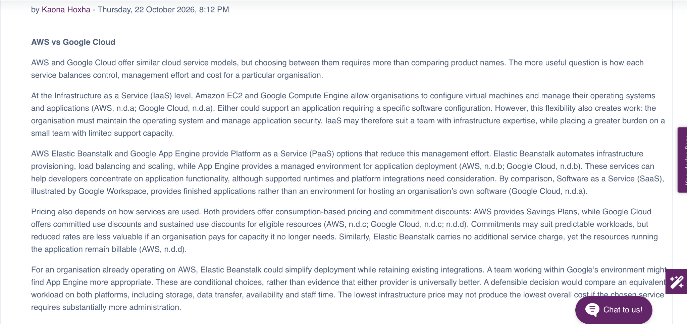
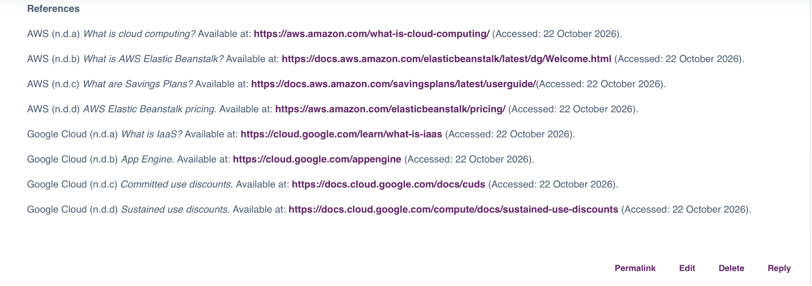
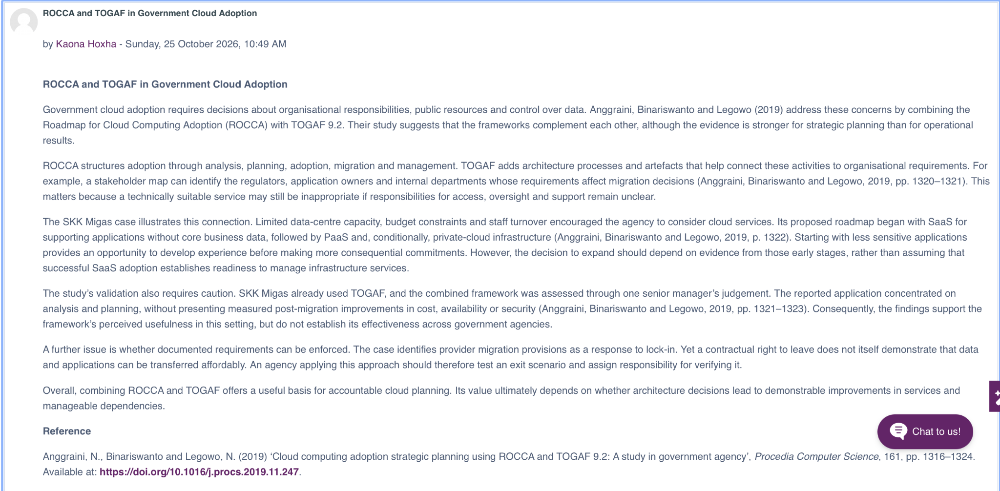
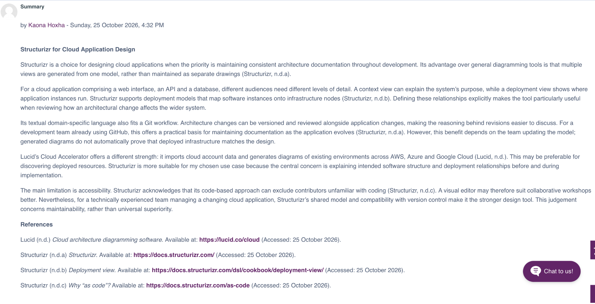

# Cloud Operations and Management

[Portfolio home](../index.md)

I have organised my work by unit, bringing together discussions, reflections, learning goals and evidence of my progress.

## Unit 1: Introduction to Cloud Fundamentals and Services

### Learning outcomes
- Define cloud computing and identify its key characteristics.
- Differentiate between IaaS, PaaS and SaaS and their applications.
- Evaluate the benefits and challenges of cloud adoption in different organisational settings.

### Progress checklist

- [x] I have prepared the provider comparison.
- [x] I posted my formative discussion on 22 October 2026.
- [x] I have watched the introductory lecturecast.
- [x] I have read Mell and Grance (2011), The NIST Definition of Cloud Computing.
- [x] I have completed the assigned Gupta (2024) reading.
- [x] I have reviewed the seminar brief and prepared my responses.
- [x] I have written my learning goals and reflective practice plan.
- [x] I have added screenshots of my post and references.
- [ ] I will record any feedback and my response to it.

### Artefact 1: AWS vs Google Cloud

I compared AWS and Google Cloud on service models, flexibility, pricing and use cases. I posted my discussion on 22 October 2026.

[Unit 1 discussion forum](https://www.my-course.co.uk/mod/forum/view.php?id=1433566) (university login required).

#### Screenshots of the published post

[Open discussion screenshot](evidence/unit-1-forum-post.png) · [Open references screenshot](evidence/unit-1-forum-references.png)

#### AWS vs Google Cloud

AWS and Google Cloud offer similar cloud service models, but choosing between them requires more than comparing product names. The more useful question is how each service balances control, management effort and cost for a particular organisation.

At the Infrastructure as a Service (IaaS) level, Amazon EC2 and Google Compute Engine allow organisations to configure virtual machines and manage their operating systems and applications (AWS, n.d.a; Google Cloud, n.d.a). Either could support an application requiring a specific software configuration. However, this flexibility also creates work: the organisation must maintain the operating system and manage application security. IaaS may therefore suit a team with infrastructure expertise, while placing a greater burden on a small team with limited support capacity.

AWS Elastic Beanstalk and Google App Engine provide Platform as a Service (PaaS) options that reduce this management effort. Elastic Beanstalk automates infrastructure provisioning, load balancing and scaling, while App Engine provides a managed environment for application deployment (AWS, n.d.b; Google Cloud, n.d.b). These services can help developers concentrate on application functionality, although supported runtimes and platform integrations need consideration. By comparison, Software as a Service (SaaS), illustrated by Google Workspace, provides finished applications rather than an environment for hosting an organisation’s own software (Google Cloud, n.d.a).

Pricing also depends on how services are used. Both providers offer consumption-based pricing and commitment discounts: AWS provides Savings Plans, while Google Cloud offers committed use discounts and sustained use discounts for eligible resources (AWS, n.d.c; Google Cloud, n.d.c; n.d.d). Commitments may suit predictable workloads, but reduced rates are less valuable if an organisation pays for capacity it no longer needs. Similarly, Elastic Beanstalk carries no additional service charge, yet the resources running the application remain billable (AWS, n.d.d).

For an organisation already operating on AWS, Elastic Beanstalk could simplify deployment while retaining existing integrations. A team working within Google’s environment might find App Engine more appropriate. These are conditional choices, rather than evidence that either provider is universally better. A defensible decision would compare an equivalent workload on both platforms, including storage, data transfer, availability and staff time. The lowest infrastructure price may not produce the lowest overall cost if the chosen service requires substantially more administration.

#### References accompanying the post

AWS (n.d.a) *What is cloud computing?* Available at: https://aws.amazon.com/what-is-cloud-computing/ (Accessed: 22 October 2026).

AWS (n.d.b) *What is AWS Elastic Beanstalk?* Available at: https://docs.aws.amazon.com/elasticbeanstalk/latest/dg/Welcome.html (Accessed: 22 October 2026).

AWS (n.d.c) *What are Savings Plans?* Available at: https://docs.aws.amazon.com/savingsplans/latest/userguide/ (Accessed: 22 October 2026).

AWS (n.d.d) *AWS Elastic Beanstalk pricing*. Available at: https://aws.amazon.com/elasticbeanstalk/pricing/ (Accessed: 22 October 2026).

Google Cloud (n.d.a) *What is IaaS?* Available at: https://cloud.google.com/learn/what-is-iaas (Accessed: 22 October 2026).

Google Cloud (n.d.b) *App Engine*. Available at: https://cloud.google.com/appengine (Accessed: 22 October 2026).

Google Cloud (n.d.c) *Committed use discounts*. Available at: https://docs.cloud.google.com/docs/cuds (Accessed: 22 October 2026).

Google Cloud (n.d.d) *Sustained use discounts*. Available at: https://docs.cloud.google.com/compute/docs/sustained-use-discounts (Accessed: 22 October 2026).

### My Unit 1 reflection

**What?**

For Unit 1, I completed the required readings and posted a comparison of AWS and Google Cloud. The comparison considered service models, flexibility, pricing and possible organisational uses. It provided an opportunity to apply the unit's concepts to decisions about infrastructure control and operational responsibility.

**So what?**

In my comparison, I examined flexibility as a trade-off. Greater control over a virtual machine also means responsibility for maintaining its operating system and applications. A managed platform may reduce that burden, but its suitability still depends on runtime requirements and integration choices. This makes the organisation's ability to operate a service part of the selection decision.

The same reasoning applies to cost. A discounted rate is only useful when the commitment fits the workload. I considered staffing effort and changing demand alongside infrastructure charges. However, I did not cost an equivalent workload on both platforms, so I cannot conclude that either provider would be cheaper in practice. I also relied on provider documentation, which explains service features but offers limited independent evidence about comparative performance.

**What next?**

For a later practical activity, I will define a small application workload and compare both providers using the same assumptions for region, availability, storage and data transfer. I will also record which management and security tasks remain with the customer. This would allow me to test the argument made in the discussion and identify where a lower hosting price creates additional operational work.

### Seminar preparation: Introduction to Cloud Computing and Reflection on Learning Goals

I prepared the following responses using the Unit 1 seminar objectives and questions.

#### 1. Differences between service models

The distinction concerns the layers the customer manages (Mell and Grance, 2011).

| Model | Customer's main control | Example | Possible application |
|---|---|---|---|
| IaaS | Operating system, installed software and applications | Amazon EC2 | Hosting software that needs a customised operating system |
| PaaS | Deployed application and its configuration, within platform limits | Google App Engine | Deploying a web application with less infrastructure administration |
| SaaS | Use and permitted configuration of a finished application | Google Workspace | Providing email and document collaboration |

These models describe different management boundaries rather than a ranking of quality. Security decisions about access and use remain relevant in each model.

#### 2. Organisational choice

A service choice should begin with the application's requirements and the organisation's capacity to support it. IaaS can accommodate a customised software environment, but the resulting maintenance work needs staff and time. PaaS can reduce infrastructure administration, provided the application fits the platform. SaaS may suit a standard business function when developing a separate application offers little benefit.

These are applications of the service-model distinction, not universal recommendations. Integration, data requirements, costs and migration constraints still need assessment. The AWS versus Google Cloud post provides an initial comparison; practical evidence is needed to test the choice for a defined workload.

#### 3. Initial personal learning goals

My learning goals are:

- I aim to explain IaaS, PaaS and SaaS using one example each and identify the main customer responsibilities.
- I aim to develop and document a small cloud deployment, including configuration choices, security considerations and limitations, where practical activities allow.
- I aim to compare the cost of one defined workload across providers and explain how assumptions affect the result.
- I aim to connect evidence from the module to development towards cloud and DevOps work, identifying remaining gaps rather than claiming competence from reading alone.

#### 4. Reflective practice plan

After each unit, I will keep a brief entry using **What? / So what? / What next?** I will describe the activity briefly, analyse one important decision or difficulty, and identify a specific next step. I will link each entry to its artefact and use literature to explain or question my decisions.

When I receive feedback, I will record the comment, my response and whether the change improved my work. I will review my skills matrix alongside these entries so my action plan reflects my progress. I will use my unit notes to develop a selective final reflection within the assessment's word limit.

#### Reading reference for seminar preparation

Mell, P. and Grance, T. (2011) *The NIST Definition of Cloud Computing*. NIST Special Publication 800-145. Gaithersburg, MD: National Institute of Standards and Technology. Available at: https://nvlpubs.nist.gov/nistpubs/Legacy/SP/nistspecialpublication800-145.pdf (Accessed: 22 October 2026).

### Feedback

I have not yet received feedback on this activity. I will record relevant comments and explain how I use them to improve my work.

## My professional skills matrix and action plan

I have linked my learning evidence to areas I want to develop further.

| Skill | Current evidence | Gap or limitation | Next action | Review point |
|---|---|---|---|---|
| Cloud service evaluation | Unit 1 provider comparison | Conceptual evaluation; no practical deployment | I will explain responsibility boundaries for one IaaS and one PaaS example | End of Unit 1 |
| Cloud cost analysis | Discussion of pricing trade-offs | No equivalent workload calculation | I will compare a defined workload using both provider calculators and record assumptions | Next relevant practical activity |
| Academic source evaluation | Provider documentation cited in discussion | Independent literature not yet integrated into reflection | I will identify and cite a specific argument that supports or challenges the comparison | Unit 1 reflection |
| Reflective practice | My Unit 1 reflection | I need to strengthen the connection to literature | I will connect specific reading insights to my decisions | Final reflection |

## Team and tutor meeting record

I will use this section to record the dates, participants, decisions and actions from my team and tutor meetings. I will submit confidential peer evaluations through the required confidential route.

## Unit 2: Understanding Cloud Architecture and Implementing Different Frameworks

### Learning outcomes

- Apply TOGAF principles to cloud architecture design.
- Implement SDLC in cloud environments.
- Utilise IaC to automate cloud infrastructure.

In this discussion, I evaluated architecture frameworks conceptually. I have not yet recorded practical SDLC or IaC implementation here.

### Progress checklist

- [x] I have analysed Anggraini, Binariswanto and Legowo (2019).
- [x] I have written my ROCCA and TOGAF discussion.
- [x] I have posted my discussion.
- [x] I have written my reflection and skills development notes.
- [x] I have read Jager (2025), Chapters 3–4.
- [ ] I will record feedback and any resulting revisions.

### Artefact: ROCCA and TOGAF in Government Cloud Adoption

I posted my discussion on 25 October 2026. The screenshot below records my post and its reference.

[Open full-size submission evidence](evidence/unit-2-rocca-togaf-post.png)

#### Discussion text

Government cloud adoption requires decisions about organisational responsibilities, public resources and control over data. Anggraini, Binariswanto and Legowo (2019) address these concerns by combining the Roadmap for Cloud Computing Adoption (ROCCA) with TOGAF 9.2. Their study suggests that the frameworks complement each other, although the evidence is stronger for strategic planning than for operational results.

ROCCA structures adoption through analysis, planning, adoption, migration and management. TOGAF adds architecture processes and artefacts that help connect these activities to organisational requirements. For example, a stakeholder map can identify the regulators, application owners and internal departments whose requirements affect migration decisions (Anggraini, Binariswanto and Legowo, 2019, pp. 1320–1321). This matters because a technically suitable service may still be inappropriate if responsibilities for access, oversight and support remain unclear.

The SKK Migas case illustrates this connection. Limited data-centre capacity, budget constraints and staff turnover encouraged the agency to consider cloud services. Its proposed roadmap began with SaaS for supporting applications without core business data, followed by PaaS and, conditionally, private-cloud infrastructure (Anggraini, Binariswanto and Legowo, 2019, p. 1322). Starting with less sensitive applications provides an opportunity to develop experience before making more consequential commitments. However, the decision to expand should depend on evidence from those early stages, rather than assuming that successful SaaS adoption establishes readiness to manage infrastructure services.

The study’s validation also requires caution. SKK Migas already used TOGAF, and the combined framework was assessed through one senior manager’s judgement. The reported application concentrated on analysis and planning, without presenting measured post-migration improvements in cost, availability or security (Anggraini, Binariswanto and Legowo, 2019, pp. 1321–1323). Consequently, the findings support the framework’s perceived usefulness in this setting, but do not establish its effectiveness across government agencies.

A further issue is whether documented requirements can be enforced. The case identifies provider migration provisions as a response to lock-in. Yet a contractual right to leave does not itself demonstrate that data and applications can be transferred affordably. An agency applying this approach should therefore test an exit scenario and assign responsibility for verifying it.

Overall, combining ROCCA and TOGAF offers a useful basis for accountable cloud planning. Its value ultimately depends on whether architecture decisions lead to demonstrable improvements in services and manageable dependencies.

#### Reference

Anggraini, N., Binariswanto and Legowo, N. (2019) ‘Cloud computing adoption strategic planning using ROCCA and TOGAF 9.2: A study in government agency’, *Procedia Computer Science*, 161, pp. 1316–1324. Available at: https://doi.org/10.1016/j.procs.2019.11.247.

### My Unit 2 reflection

**What?** I examined the use of ROCCA and TOGAF 9.2 in the SKK Migas case and prepared a discussion evaluating the proposed framework. The activity required distinguishing the authors' account of its usefulness from evidence of its effectiveness.

**So what?** The important distinction is between producing a structured adoption plan and demonstrating that the resulting service works well. The case maps adoption activities to architecture artefacts, but its evaluation concentrates on planning and one manager's judgement (Anggraini, Binariswanto and Legowo, 2019, pp. 1321–1323). This limits the conclusions that can be drawn about savings, resilience and security after migration. The discussion also examines whether a requirement has been verified in practice: specifying an exit provision does not establish that migration is technically feasible or affordable. This develops the Unit 1 comparison by considering how an organisation could govern and test its cloud decisions.

**What next?** In the team project, I propose linking each important architecture requirement to an owner, evidence and an acceptance criterion. For portability, an example would be testing an export and recovery process and recording the time, dependencies and costs. I will also use the required Jager chapters to refine the architecture analysis using relevant notes from the completed reading.

### Skills and action-plan update

| Skill | Evidence from Unit 2 | Limitation | Proposed next action |
|---|---|---|---|
| Framework evaluation | Comparison of ROCCA's adoption roadmap with TOGAF artefacts | One case; no independent framework implementation | I will apply selected artefacts to the team project and justify the selection |
| Critical appraisal | Distinguishes planning validation from operational outcomes | Does not provide an alternative empirical evaluation | I will define measurable success criteria for a proposed migration |
| Requirements and governance | Analysis of stakeholders and provider exit provisions | Exit feasibility has not been tested | I will specify a requirement owner and a practical portability test |

### Feedback

I have not yet received feedback. I will record any comments and the changes I make in response.

## Unit 3: Cloud Design Tools

### Learning outcomes

- Understand how AI enhances cloud service performance.
- Analyse real-world use cases of AI-driven cloud platforms.
- Evaluate the benefits of integrating AI into cloud systems.

I compared Structurizr with Lucid in my Summary and explored IaaS, PaaS and SaaS through recent AI product developments in my fundamentals reflection.

### Progress checklist

- [x] I have written my 300-word cloud design tool Summary.
- [x] I have posted my Summary.
- [x] I have saved my Summary and screenshot.
- [ ] I will read and respond to a peer's post in 300 words excluding references when a post is available.
- [x] I have completed and saved my 300-word Cloud computing fundamentals reflection.
- [ ] I will complete the Unit 3 lecturecast.
- [ ] I will complete the required Kubernetes Book reading.
- [ ] I will use any feedback to update my reflection.

### Artefact 1: Summary — Structurizr for Cloud Application Design

I posted my Summary on 25 October 2026. I have included a screenshot of my post and references below.

[Open full-size Summary evidence](evidence/unit-3-structurizr-summary.png)

Structurizr is a choice for designing cloud applications when the priority is maintaining consistent architecture documentation throughout development. Its advantage over general diagramming tools is that multiple views are generated from one model, rather than maintained as separate drawings (Structurizr, n.d.a).

For a cloud application comprising a web interface, an API and a database, different audiences need different levels of detail. A context view can explain the system’s purpose, while a deployment view shows where application instances run. Structurizr supports deployment models that map software instances onto infrastructure nodes (Structurizr, n.d.b). Defining these relationships explicitly makes the tool particularly useful when reviewing how an architectural change affects the wider system.

Its textual domain-specific language also fits a Git workflow. Architecture changes can be versioned and reviewed alongside application changes, making the reasoning behind revisions easier to discuss. For a development team already using GitHub, this offers a practical basis for maintaining documentation as the application evolves (Structurizr, n.d.a). However, this benefit depends on the team updating the model; generated diagrams do not automatically prove that deployed infrastructure matches the design.

Lucid’s Cloud Accelerator offers a different strength: it imports cloud account data and generates diagrams of existing environments across AWS, Azure and Google Cloud (Lucid, n.d.). This may be preferable for discovering deployed resources. Structurizr is more suitable for my chosen use case because the central concern is explaining intended software structure and deployment relationships before and during implementation.

The main limitation is accessibility. Structurizr acknowledges that its code-based approach can exclude contributors unfamiliar with coding (Structurizr, n.d.c). A visual editor may therefore suit collaborative workshops better. Nevertheless, for a technically experienced team managing a changing cloud application, Structurizr’s shared model and compatibility with version control make it the stronger design tool. This judgement concerns maintainability, rather than universal superiority.

#### References for the Summary

Lucid (n.d.) *Cloud architecture diagramming software*. Available at: https://lucid.co/cloud (Accessed: 25 October 2026).

Structurizr (n.d.a) *Structurizr*. Available at: https://docs.structurizr.com/ (Accessed: 25 October 2026).

Structurizr (n.d.b) *Deployment view*. Available at: https://docs.structurizr.com/dsl/cookbook/deployment-view/ (Accessed: 25 October 2026).

Structurizr (n.d.c) *Why “as code”?* Available at: https://docs.structurizr.com/as-code (Accessed: 25 October 2026).

### Artefact 2: Peer Response

I am waiting for a peer to post before writing my response. I will engage with their argument and support my response with relevant sources.

### Artefact 3: Cloud computing fundamentals — reflection

Comparing IaaS, PaaS and SaaS has helped me frame cloud adoption as a decision about responsibility, rather than a choice of provider. The models differ in how much of the technology stack the customer controls: infrastructure services allow operating-system management, platforms support application deployment, and software services provide finished applications (Mell and Grance, 2011).

IaaS is appropriate when a workload needs specialised configurations. AWS’s introduction of EC2 P6-B200 instances in May 2025 illustrates how infrastructure services support demanding AI training and inference workloads (AWS, 2025). However, access to powerful hardware does not remove the need for software maintenance, security configuration and cost control. I would therefore assess whether the organisation has the expertise to use that flexibility effectively.

PaaS offers a different balance. Google’s announcement of generally available GPU support for Cloud Run in June 2025 shows that managed application platforms can also accommodate AI inference (Giannini and Xiao, 2025). Cloud Run represents a serverless platform approach: developers deploy applications while the provider manages underlying infrastructure. This challenges the assumption that advanced workloads always require direct infrastructure management. Nevertheless, supported hardware and platform constraints still affect suitability.

SaaS suits organisations seeking established functionality without developing the application themselves. Microsoft’s January 2025 introduction of Microsoft 365 Copilot Chat illustrates AI functionality being delivered through existing business software (Spataro, 2025). Operational simplicity does not remove the need to govern access, assess data handling and check outputs.

The main lesson is that AI adoption spans all three models; it does not determine which model an organisation should choose. These announcements illustrate product developments, rather than proving market-wide adoption or better outcomes. In future comparisons, I will start with workload requirements, available skills and acceptable dependencies, then assess total operating effort. This should produce a more defensible recommendation than choosing the most flexible service.

#### References for the fundamentals reflection

AWS (2025) *Amazon EC2 P6-B200 instances powered by NVIDIA B200 GPUs now generally available*. 15 May. Available at: https://aws.amazon.com/about-aws/whats-new/2025/05/amazon-ec2-p6-b200-instances-nvidia-b200-gpus/ (Accessed: 25 October 2026).

Giannini, S. and Xiao, Y. (2025) *Cloud Run GPUs, now GA, makes running AI workloads easier for everyone*. 2 June. Available at: https://cloud.google.com/blog/products/serverless/cloud-run-gpus-are-now-generally-available (Accessed: 25 October 2026).

Mell, P. and Grance, T. (2011) *The NIST Definition of Cloud Computing*. NIST Special Publication 800-145. Gaithersburg, MD: National Institute of Standards and Technology. Available at: https://nvlpubs.nist.gov/nistpubs/Legacy/SP/nistspecialpublication800-145.pdf (Accessed: 25 October 2026).

Spataro, J. (2025) *Copilot for all: Introducing Microsoft 365 Copilot Chat*. 15 January. Available at: https://www.microsoft.com/en-us/microsoft-365/blog/2025/01/15/copilot-for-all-introducing-microsoft-365-copilot-chat/ (Accessed: 25 October 2026).

### Skills and action-plan notes

| Skill | Current evidence | Limitation | Next step |
|---|---|---|---|
| Design-tool selection | Structurizr Summary compares maintainability, modelling and accessibility with Lucid | Documentation-based comparison; no hands-on benchmark | I will test how a small model change affects multiple views in a later design activity |
| Cloud service evaluation | Fundamentals reflection links service boundaries to AI examples | Product announcements do not establish adoption or performance outcomes | I will apply the comparison to a defined workload and justify a service model |
| Peer discussion | Summary posted | Response not yet possible | I will respond to one actual peer post when available |

## Later units and final submission

Before final submission, I will:
- Check the module-specific e-Portfolio brief and rubric, including the 2,000-word requirement and what it includes.
- Select and connect the strongest evidence to the full module learning outcomes.
- Complete the critical reflection, skills matrix and action plan.
- Check navigation and access to every submitted artefact.
- Create the required submission branch and configure GitHub Pages in line with the university guidance.
- Record my submitted branch, commit and Pages URL.
