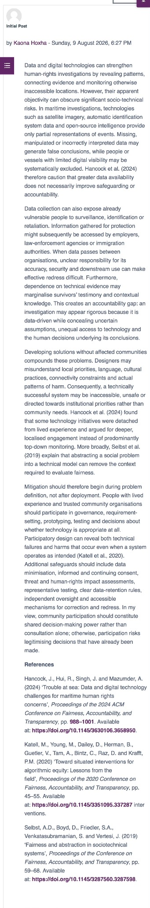
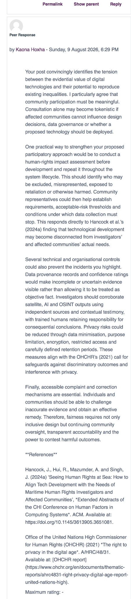
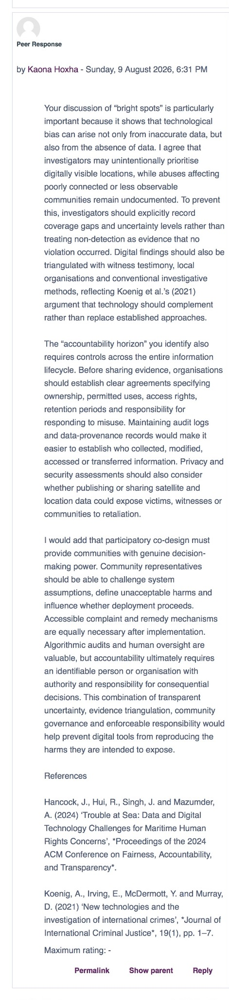
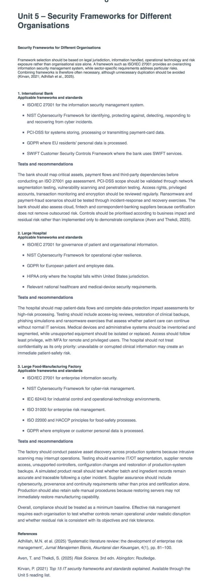
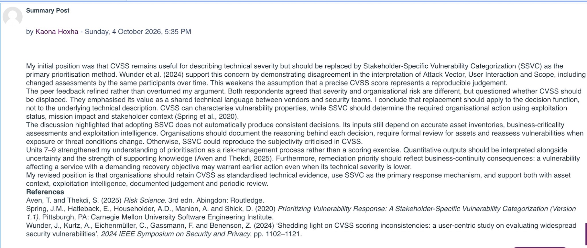

# Security and Risk Management

[Back to the e-Portfolio homepage](../index.md)

## Portfolio Overview

This page records my development across the Security and Risk Management module. It brings together discussion work, threat-modelling exercises, the group risk-identification project, quantitative modelling, disaster-recovery design and tutor feedback. The artefacts are presented as evidence of development rather than as a collection of finished products: each unit states what I produced, what changed in my thinking and where the evidence can be inspected.

## Evidence Map

| Unit | Development demonstrated | Main evidence |
|---|---|---|
| 1 | Recognising social, legal and evidential risks in technology-supported investigations | [Collaborative Discussion 1 initial post](evidence/Unit_1_CLD1_Initial_Post.jpg) |
| 2 | Using peer dialogue to improve controls, participation and accountability | [Peer response 1](evidence/Unit_2_CLD1_Peer_Response_1.jpg) and [peer response 2](evidence/Unit_2_CLD1_Peer_Response_2.jpg) |
| 3 | Selecting threat-modelling methods according to the decision required | Method-comparison artefact below |
| 4 | Applying threat modelling to cyber-physical systems | Cyber-physical threat table below |
| 5 | Matching standards and frameworks to organisational context | [Module Wiki contribution](evidence/Unit_5_Module_Wiki.jpg) and GDPR case study below |
| 6 | Team risk assessment, leadership, editing and evidence-based recommendation | [Final group report](evidence/Unit_6_Risk_Identification_Report.docx), [team contract](evidence/Unit_6_Team_Contract.docx), [peer evaluation](evidence/Unit_6_Peer_Evaluation.docx) and [tutor feedback](evidence/Unit_6_Tutor_Feedback.md) |
| 7 | Critiquing CVSS and arguing for contextual prioritisation | Collaborative Discussion 2 initial-post analysis below |
| 8 | Developing quantitative-risk reasoning and responding to peers | Monte Carlo learning note and discussion evidence below |
| 9 | Integrating discussion learning with business continuity and recovery objectives | [Collaborative Discussion 2 summary post](evidence/Unit_9_CLD2_Summary_Post.jpg) |
| 10 | Comparing DR strategies against explicit RTO and RPO requirements | DR design-review artefact below |
| 11 | Building and evaluating a quantitative risk model and DR recommendation | [Executive summary](Kaona_Hoxha_Pampered_Pets_Executive_Summary.docx), [risk model](Pampered_Pets_Quantitative_Risk_Model.xlsx) and [tutor feedback](evidence/Unit_11_Tutor_Feedback.md) |
| 12 | Integrating evidence into a critical account of development | Final reflection to be completed before submission |

## Unit Learning and Artefacts

### Unit 1 – Introduction to Security and Risk Management

My initial discussion post examined how incomplete data, surveillance, unequal technological visibility and the exclusion of community knowledge can undermine human-rights investigations. The exercise made clear that technically valid evidence may still be socially incomplete. Hancock et al. (2024) show that digital evidence can lose the context required for sound interpretation, while Selbst et al. (2019) warn that technical systems can fail when separated from the institutions and social settings in which they operate.

My starting position was that better data quality would resolve most problems. I later recognised that provenance, contestability and representation are separate requirements: accurate data may still be collected unfairly, interpreted without local knowledge or used without an effective route for correction.

View Unit 1 evidence

### Unit 2 – Users, Assessments and the Risk Management Process

I wrote two peer responses that moved beyond agreement and proposed practical measures: human-rights impact assessment, triangulation, provenance records, community governance, independent oversight and accessible correction mechanisms. This changed how I understand participation in risk management. Participation is not simply a method for obtaining better requirements; it should give affected people meaningful influence over acceptable harm, data use and whether deployment should proceed. This is consistent with work on contestability and public participation in algorithmic systems (Katell et al., 2020; OHCHR, 2021).

View Unit 2 evidence

### Unit 3 – Threat-Modelling Method Selection

| Method | Decision supported | Strength | Limitation |
|---|---|---|---|
| STRIDE | What can go wrong across identities, components and data flows? | Systematic coverage of common technical threats | Does not determine business impact or priority |
| Attack trees | How could an attacker achieve a defined objective? | Exposes alternative paths and dependencies | Completeness depends heavily on analyst knowledge |
| PASTA | How do plausible attack scenarios affect business objectives? | Connects technical analysis to business impact | Requires more time, information and stakeholder input |
| DREAD | Which threats appear most severe? | Simple comparative scoring | Subjective inputs can create unsupported numerical precision |

I initially treated threat-modelling methods as interchangeable checklists. Comparing them showed that method selection is itself a risk decision. STRIDE is useful for coverage, attack trees for pathways and PASTA for business alignment; none is universally superior (Shevchenko et al., 2018). DREAD can assist discussion, but its arithmetic does not remove uncertainty. Aven and Thekdi (2025) therefore influenced me to judge a model not only by its output, but by the quality of knowledge supporting that output.

**Evidence of development:** I moved from asking which framework was “best” to asking which decision the model must support and what it leaves unexamined.

### Unit 4 – Applied Threat Modelling in a Cyber-Physical Environment

| Entry point | Threat scenario | Operational consequence | Proportionate controls |
|---|---|---|---|
| Remote supplier access | Credentials are compromised | Unsafe production change or loss of availability | MFA, restricted access, least privilege and monitoring |
| IT/OT connection | Malware crosses into operational systems | Production interruption or unsafe state | Segmentation, controlled gateways and allowlisting |
| Sensors and production data | Readings are altered or replayed | Decisions are made using false process information | Authentication, integrity checks, anomaly detection and reconciliation |
| Update mechanism | Malicious or defective software is installed | Persistent compromise across equipment | Signed updates, supplier assurance, testing and rollback |
| Central management platform | One service failure affects multiple processes | Concentrated operational disruption | Redundancy, fail-safe states and rehearsed manual procedures |

Jbair et al. (2022) helped me connect threat modelling to the architecture and operating dependencies of smart manufacturing. Zografopoulos et al. (2021) further show that cyber-physical risk cannot be evaluated only as loss of confidentiality, integrity or availability: a digital incident can become a safety, product-quality or continuity event. The key lesson was to trace each technical event through to its physical and business consequence before prioritising treatment.

### Unit 5 – Security and Risk Standards

My Wiki contribution compared how a bank, hospital and food manufacturer would use different combinations of governance, privacy, technical and sector-specific controls. The exercise showed that adopting a recognised framework does not by itself demonstrate appropriate risk treatment. Selection must reflect assets, legal duties, operational dependencies and the consequences of failure.

View Unit 5 Wiki evidence

#### GDPR Case Study: Transmission of Visa Data Through WhatsApp

The case concerned Ireland’s Department of Foreign Affairs and Trade sending a visa-supporting document through WhatsApp to the applicant’s employer to verify authenticity. The employer lacked an official email account, so the mission completed a local risk assessment, relied on end-to-end encryption and deleted the document from the staff device after transmission (Data Protection Commission, 2019).

Although the processing pre-dated the GDPR, the case illustrates lawfulness, purpose limitation, data minimisation, integrity and confidentiality, and accountability. A contemporary assessment would require a documented lawful basis and evidence that disclosure was necessary and proportionate. Article 32 does not prescribe a particular application; the relevant question is whether security is appropriate to the processing risk. Encryption therefore matters, but so do recipient verification, device management, retention, access and governance. A transfer to Egypt would also require assessment under Chapter V and careful documentation of any Article 49 derogation (EDPB, 2018).

The DPC found no contravention because verification was necessary, the employer was identified in the application, applicants had been informed that supporting material could be verified, and proportionate security measures had been taken. My main learning was that neither the label “consumer application” nor the presence of encryption decides compliance. The defensible conclusion depends on purpose, necessity, transparency and the complete control environment.

### Unit 6 – Development Team Project: Risk Identification Report

The group assessed the current Pampered Pets model and the risks introduced or transferred by digitalisation. We recommended selective, reversible digitalisation: stabilise the existing environment, then pilot click-and-collect, online product information and cloud traceability while retaining local supply and in-store payment. The report used ISO 31000 to frame the decision, STRIDE for digital threats and qualitative scenarios for food safety, capacity and supplier economics (AIRMIC, Alarm and IRM, 2010; Shevchenko et al., 2018).

My individual responsibility was the proposed-transformation assessment. As project lead, I also repeatedly contacted the group, set internal deadlines, created the shared document, integrated four drafts and reduced the report from 2,023 to 964 words. I standardised the methodology, ratings, terminology, citations and British English, checked the brief and word count, ran the originality check and submitted the final report. The signed contract and peer-evaluation form support these claims.

The report received **77%**. The tutor identified the critical comparison of the 50%, 24% and 33% claims, the interaction between risks and the reversible pilot as particular strengths. The weaknesses were equally useful: the likelihood-impact scale was not fully defined; the report did not consistently assign owners, timescales or residual risks; affordability and risk acceptance required more analysis; and the final document was visually dense. These points became explicit design requirements for my later individual project.

- [Final risk-identification report](evidence/Unit_6_Risk_Identification_Report.docx)
- [Signed team contract](evidence/Unit_6_Team_Contract.docx)
- [Individual peer evaluation](evidence/Unit_6_Peer_Evaluation.docx)
- [Tutor feedback and mark](evidence/Unit_6_Tutor_Feedback.md)

### Unit 7 – Quantitative Risk and Vulnerability Prioritisation

For Collaborative Discussion 2, I examined Wunder et al.’s (2024) evidence that CVSS scores are not as reproducible as their precision suggests. I agreed that ambiguous interpretation of Attack Vector, User Interaction and Scope weakens consistency, but I did not conclude that CVSS has no value. It remains a shared description of technical severity; the error is treating that severity as organisational risk.

I argued that Stakeholder-Specific Vulnerability Categorization (SSVC) should become the primary prioritisation method because it makes decision logic visible and connects exploitation, technical impact and mission relevance to an action (Spring et al., 2020). CVSS can remain an input, but should not determine remediation priority by itself (FIRST, 2020). This distinction between measurement and decision later influenced how I presented the Monte Carlo results: a number informs judgement but does not set risk appetite.

### Unit 8 – Implementing Quantitative Risk Models

The Unit 8 work introduced Monte Carlo simulation as a way to propagate uncertain inputs rather than conceal them inside a single expected value (Eckstein and Riedmueller, 2002). I learned that a larger simulation does not repair weak assumptions. The quality of a quantitative model depends on transparent distributions, dependency assumptions, sensitivity testing and evidence for control effectiveness.

My peer engagement in Collaborative Discussion 2 also sharpened the CVSS/SSVC argument. One response challenged whether SSVC should replace CVSS entirely. That prompted a more defensible position: retain CVSS for interoperable technical description, but use SSVC for context-sensitive action. The exchange demonstrated that peer response is most useful when it tests the boundary of an argument rather than simply endorsing it.

### Unit 9 – Risk, Business Continuity and Disaster Recovery

My summary post brought together the initial CVSS critique, peer feedback and the wider unit learning. I concluded that vulnerability management requires a chain from technical description to organisational context and then to accountable action. The same reasoning applies to continuity planning: an RTO or RPO is not a technology label but a business requirement that must be justified through impact analysis and demonstrated through testing (Sutton, 2021).

View Unit 9 evidence

### Unit 10 – Disaster-Recovery Design Review

Business requirements should be defined before selecting a recovery technology. RTO states how quickly a service must be restored; RPO states how much data loss is tolerable. Neither is meaningful unless it applies to an end-to-end business service and has been tested (Sutton, 2021).

| Strategy | Operating model | Main limitation | Suitability for a sub-minute target |
|---|---|---|---|
| Backup and restore | Rebuild service from retained data | Recovery takes hours and recent transactions may be lost | Unsuitable |
| Pilot light | Keep essential components running, then start and scale the remainder | Start-up, validation and dependency delays | Unlikely to comply |
| Warm standby | Maintain a reduced-capacity live environment | Scaling and redirection still consume the recovery window | Suitable only for less demanding objectives |
| Active-active | Serve traffic from more than one location | Cost, operational complexity and data-conflict risk | Strongest candidate, subject to end-to-end testing |

Cloud deployment does not by itself guarantee recovery. Alhazmi and Malaiya (2013) and Andrade et al. (2017) show that availability depends on architecture, dependencies and failure assumptions. For Pampered Pets, an active-active design was therefore a candidate architecture, not proof of compliance. A valid test must complete the whole mission thread—accept an order, authorise payment, reserve stock, issue warehouse instructions and preserve confirmation—rather than show only that a server is healthy (Corbari, 2024).

Vendor lock-in also requires proportionate treatment. Isolating provider-specific APIs, using infrastructure-as-code, exporting data in documented formats and testing restoration elsewhere improve exit capability (Kumar, 2024). However, a fully duplicated multi-cloud design is not automatically safer: added complexity may itself threaten a sub-minute recovery objective.

### Unit 11 – Individual Project: Executive Summary

The individual project estimated annual probabilities that international sourcing and automated warehouses would endanger product quality or availability. I built a 10,000-trial Monte Carlo workbook that separated hazard occurrence from escalation into material harm, introduced a shared stress factor and used sensitivity analysis to prioritise controls. The report paired the model with supplier-quality controls, staged expansion, an active-active recovery proposal, GDPR requirements and vendor-lock-in treatment.

The project received **75%**. The tutor credited the occurrence/escalation distinction, detailed spreadsheet, sensitivity analysis and conditional pilot recommendation. The feedback also exposed important weaknesses. The assumed improvements in escalation rates were not supported strongly enough; one dependency scenario was insufficient; the regional architecture needed more specificity and testing; sensitivity and convergence evidence remained static after recalculation; the report and workbook contained slightly different results; and the workbook claimed a fixed seed while using unseeded `RANDARRAY`. This was a valuable reminder that traceability includes the behaviour of the artefact, not only the prose that describes it.

- [Executive summary](Kaona_Hoxha_Pampered_Pets_Executive_Summary.docx)
- [Monte Carlo workbook](Pampered_Pets_Quantitative_Risk_Model.xlsx)
- [Tutor feedback and mark](evidence/Unit_11_Tutor_Feedback.md)

### Unit 12 – Consolidation

The final task is to convert the evidence above into a critical reflection rather than repeat the unit summaries. The reflection will examine how my approach changed, where my leadership helped or constrained the team, how tutor and peer feedback altered later decisions, and what I will do differently in future risk work.

## Individual Contribution and Collaboration

The strongest evidence of my contribution is the relationship between the team contract, final report, peer evaluation and tutor feedback. My allocated analysis covered transformation risk, but my role expanded when participation was slow. I followed up repeatedly, proposed the work split and deadlines, maintained the shared document, integrated all four sections and performed the final quality review.

Reducing 2,023 words to 964 without losing the required comparison was not merely copy-editing. I removed repetition, reconciled conflicting recommendations, converted unsupported percentages into testable claims and imposed a common method across separately written contributions. The result was coherent, but taking on integration late also created avoidable pressure and limited the time available for visual presentation and a formal risk register. In future I would establish an evidence template, rating definitions, owners and internal review gates at the beginning, then assign a second team member to verify the integrated draft. Leadership should create shared accountability rather than make one person the final control.

## Evaluation of the Unit 11 Project Against the Unit 6 Status Report

The two projects concerned the same organisation but required different decisions. Unit 6 asked whether Pampered Pets should digitalise; Unit 11 assumed expansion and asked how likely quality and availability failures were, and how the online service could satisfy demanding recovery objectives.

Unit 6 used ISO 31000 and STRIDE appropriately for a data-poor case (AIRMIC, Alarm and IRM, 2010; Shevchenko et al., 2018). Its strongest contribution was not the list of controls but its challenge to the claimed 50% growth, 24% saving and 33% customer loss. It showed that these claims interact: growth could overload fulfilment, while cheaper sourcing could damage the quality and local identity intended to support growth. The tutor awarded 77% but noted that rating definitions, owners, timescales, residual risks and the side-by-side comparison needed greater precision.

Unit 11 responded by using a 10,000-trial Monte Carlo model to separate occurrence from escalation and show ranges and sensitivity rather than a single deterministic estimate (Eckstein and Riedmueller, 2002). It also specified legal launch conditions and a recovery design. Yet the 75% result—two marks below Unit 6—showed that greater mathematical complexity is not automatically stronger analysis. Control-effectiveness assumptions remained judgement-based; one shared stress factor could not represent all dependencies; optimistic, central and adverse control scenarios were absent; and the recovery design was proposed rather than demonstrated.

The workbook created an additional integrity problem: it described a fixed seed while using unseeded `RANDARRAY`, so recalculation changed the results, while some sensitivity and convergence outputs did not update. Small discrepancies then appeared between the report and workbook. My main lesson is that a model must be internally consistent, reproducible and challengeable before its precision can add value. Future work will combine the clarity of Unit 6—explicit decision criteria, reversibility and challenge to unsupported claims—with Unit 11’s quantified uncertainty, but only where inputs, dependencies and control effects are evidenced sufficiently (Aven and Thekdi, 2025).

## Professional Skills Development

| Skill | Evidence | Development demonstrated |
|---|---|---|
| Risk identification | Unit 3–6 artefacts and group report | Moved from listing threats to connecting assets, vulnerabilities, consequences and decision context |
| Quantitative analysis | Unit 8 learning and Unit 11 workbook | Learned to disclose assumptions, model uncertainty and test sensitivity; identified reproducibility weaknesses |
| Critical evaluation | Three-claims analysis and Unit 6/11 comparison | Challenged apparently precise claims and distinguished model output from risk appetite |
| Communication | Two collaborative discussions and final reports | Adapted complex issues for peer, academic and executive audiences |
| Leadership and teamwork | Contract, peer evaluation and integrated report | Coordinated contributions and quality, while recognising the need to distribute assurance work earlier |
| Professional judgement | GDPR case, DR design and feedback response | Treated compliance and resilience as evidence-based decisions rather than product labels |

## Development Action Plan

- Define likelihood, impact and risk-acceptance criteria before scoring; record asset, threat, vulnerability, consequence, owner, deadline and residual risk in one register.
- Support numerical ranges and control-effectiveness claims with operational data or published evidence; where evidence is weak, compare favourable, central and adverse scenarios.
- Model material dependencies explicitly and test whether the recommendation survives alternative assumptions.
- Freeze and label model versions, reconcile every reported figure to the workbook and ensure sensitivity and convergence outputs recalculate with the simulation.
- Test recovery against the complete customer transaction and record achieved RTO and RPO rather than claiming compliance from architecture alone.
- Set team templates and internal review gates early, and assign independent checking so that integration does not become a single-person dependency.

## References

AIRMIC, Alarm and IRM (2010) *A structured approach to enterprise risk management and the requirements of ISO 31000*. London: Association of Insurance and Risk Managers in Industry, Alarm and Institute of Risk Management.

Alhazmi, O.H. and Malaiya, Y.K. (2013) ‘Evaluating disaster recovery plans using the cloud’, *Proceedings of the Annual Reliability and Maintainability Symposium*, pp. 1–6. doi: 10.1109/RAMS.2013.6517700.

Andrade, E., Nogueira, B., Matos, R., Callou, G. and Maciel, P. (2017) ‘Availability modeling and analysis of a disaster-recovery-as-a-service solution’, *Computing*, 99(10), pp. 929–954. doi: 10.1007/s00607-017-0539-8.

Aven, T. and Thekdi, S. (2025) *Risk Science*. 3rd edn. Abingdon: Routledge.

Corbari, G. (2024) *Mission Thread Analysis: Establishing a Common Framework in a Multi-discipline Domain to Enhance Defensive Cyberspace Operations*.

Data Protection Commission (2019) *Annual Report 2019*. Dublin: Data Protection Commission.

Eckstein, J. and Riedmueller, S.T. (2002) ‘YASAI: Yet another add-in for teaching elementary Monte Carlo simulation in Excel’, *INFORMS Transactions on Education*, 2(2), pp. 12–26. doi: 10.1287/ited.2.2.12.

European Data Protection Board (EDPB) (2018) *Guidelines 2/2018 on derogations of Article 49 under Regulation 2016/679*. Brussels: EDPB.

European Parliament and Council of the European Union (2016) ‘Regulation (EU) 2016/679 of 27 April 2016’, *Official Journal of the European Union*, L119, pp. 1–88.

FIRST (2020) *Common Vulnerability Scoring System v3.1: Specification Document*. Available at: https://www.first.org/cvss/v3.1/specification-document (Accessed: 17 September 2026).

Hancock, J., Hui, R., Singh, J. and Mazumder, A. (2024) ‘Trouble at sea: Data and digital technology challenges for maritime human rights concerns’, in *Proceedings of the 2024 ACM Conference on Fairness, Accountability, and Transparency*, pp. 988–1001. doi: 10.1145/3630106.3658950.

Jbair, M., Ahmad, B., Maple, C. and Harrison, R. (2022) ‘Threat modelling for industrial cyber physical systems in the era of smart manufacturing’, *Computers in Industry*, 137, 103611. doi: 10.1016/j.compind.2022.103611.

Katell, M., Young, M., Dailey, D., Herman, B., Guetler, V., Tam, A., Bintz, C., Raz, D. and Krafft, P.M. (2020) ‘Toward situated interventions for algorithmic equity: Lessons from the field’, in *Proceedings of the 2020 Conference on Fairness, Accountability, and Transparency*, pp. 45–55. doi: 10.1145/3351095.3372874.

Kumar, A. (2024) *Cloud Vendor Lock-In: Identify, Strategies and Mitigate*. Seminar paper. Würzburg: Julius-Maximilians-Universität Würzburg.

Office of the United Nations High Commissioner for Human Rights (OHCHR) (2021) *The right to privacy in the digital age*. A/HRC/48/31. Geneva: United Nations.

Renn, O., Beier, G. and Schweizer, P.-J. (2021) ‘The opportunities and risks of digitalisation for sustainable development: a systemic perspective’, *GAIA – Ecological Perspectives for Science and Society*, 30(1), pp. 23–28. doi: 10.14512/gaia.30.1.6.

Selbst, A.D., Boyd, D., Friedler, S.A., Venkatasubramanian, S. and Vertesi, J. (2019) ‘Fairness and abstraction in sociotechnical systems’, in *Proceedings of the Conference on Fairness, Accountability, and Transparency*, pp. 59–68. doi: 10.1145/3287560.3287598.

Shevchenko, N., Chick, T.A., O’Riordan, P., Scanlon, T.P. and Woody, C. (2018) *Threat Modeling: A Summary of Available Methods*. Pittsburgh, PA: Carnegie Mellon University Software Engineering Institute.

Spring, J.M., Hatleback, E., Householder, A.D., Manion, A. and Shick, D. (2020) *Prioritizing Vulnerability Response: A Stakeholder-Specific Vulnerability Categorization (Version 1.1)*. Pittsburgh, PA: Carnegie Mellon University Software Engineering Institute.

Sutton, D. (2021) *Information Risk Management*. 2nd edn. Swindon: BCS Learning & Development Ltd.

Wunder, J., Kurtz, A., Eichenmüller, C., Gassmann, F. and Benenson, Z. (2024) ‘Shedding light on CVSS scoring inconsistencies: A user-centric study on evaluating widespread security vulnerabilities’, in *2024 IEEE Symposium on Security and Privacy*, pp. 1102–1121. doi: 10.1109/SP54263.2024.00058.

Zografopoulos, I., Ospina, J., Liu, X. and Konstantinou, C. (2021) ‘Cyber-physical energy systems security: Threat modeling, risk assessment, resources, metrics, and case studies’, *IEEE Access*, 9, pp. 29775–29818. doi: 10.1109/ACCESS.2021.3058403.
